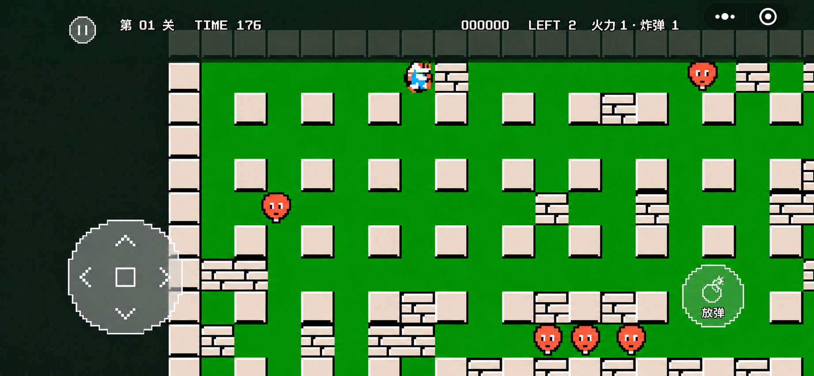

# Bomberman


基于 **Cocos Creator 3.8.6 + TypeScript** 的 NES Bomberman 复刻实验项目，支持本地电脑浏览器和微信小游戏构建。当前版本 **0.5.1**。

## 当前内容

- 50 个普通关卡、9 个奖励关、8 类敌人、8 种道具和隐藏奖励。
- 原版关卡配置与随机生成规则、20 字符续关密码、待机演示和结局动画。
- 键盘操作、横屏触控、独立跟随镜头和设备安全区域适配。
- 白色半透明细像素按键、单行无底框 HUD、中文像素字体。
- 暂停、声音开关、重开确认与切后台暂停。

界面设计稿：



这张图是设计参考；当前构建与验收范围见 [验证记录说明](docs/verification-status.md)。

## 本地运行

需要 Node.js 20 或更新版本、Python 3，以及 Cocos Creator **3.8.6**。仅运行核心测试不需要安装 Cocos。

```sh
git clone https://github.com/Lee-42/Bomberman.git
cd Bomberman
npm ci
```

先用 Cocos Creator 导入并打开仓库根目录，让编辑器完成资源导入。

macOS 默认构建工具路径为 `/Applications/Cocos/Creator/3.8.6/CocosCreator.app/Contents/MacOS/CocosCreator`。安装位置不同时，通过 `COCOS_CREATOR` 环境变量指定可执行文件。

```sh
npm run build:web
npm start
```

然后访问 <http://127.0.0.1:8770/>。macOS 也可以在构建后双击 `启动试玩.command`。

## 操作

| 操作 | 电脑键盘 |
| --- | --- |
| 移动 | 方向键 / WASD |
| 开始、确认 | Enter |
| 放置炸弹 | Space |
| 遥控引爆 | B（取得遥控道具后） |
| 暂停 / 恢复 | P |
| 重开确认 | R |
| 声音开关 | M |
| 菜单 / 选择 | Tab |

手机横屏使用左侧方向盘和右侧放弹键；取得遥控道具后显示引爆键。

## 微信小游戏

创建自己的小游戏账号，复制配置模板并填写小游戏 AppID：

```sh
cp config/wechat.example.json config/wechat.local.json
npm run build:wechat
```

也可以设置 `WECHAT_APP_ID` 环境变量。`config/wechat.local.json` 不提交到 Git。

构建产物在 `build/wechatgame/`。在微信开发者工具中按 **小游戏** 类型导入该目录，使用该账号的管理员或开发者微信登录，再执行预览。

构建脚本设置横屏并处理引擎、内部资源和游戏资源分包。预览二维码应在自己的开发者工具中重新生成；仓库不保存临时二维码、账号密钥或本机配置。微信入口头像需在公众平台后台使用 [已选图标](branding/app-icon.png) 单独配置。

## 代码结构

| 路径 | 内容 |
| --- | --- |
| `assets/core/` | 独立游戏规则、密码、演示与结局状态机 |
| `assets/content/original/` | 原版配置与数据表 |
| `assets/platform/` | 输入状态、横屏布局与显示镜头 |
| `assets/presentation/` | Cocos 渲染、声音与触控 HUD |
| `assets/resources/` | 图像、音频和像素字体 |
| `branding/` | 正式选定的项目图标 |
| `designs/` | 界面和图标设计迭代 |
| `tests/` | 核心规则与布局测试 |
| `verification/` | 测试所需的原版参考向量和输入回放 |
| `tools/` | Web / 微信构建与品牌图标处理 |

游戏规则与平台、显示层分开，便于后续替换原创素材、调整玩法或演进为其他显示形式。

## 检查命令

```sh
npm test
```

Cocos 完成导入后，可使用 `npx tsc --noEmit` 检查类型；完成 Web 构建后可运行 `npm run verify:web` 检查构建产物中的规则模块。具体历史结果与未验证项见 [验证记录说明](docs/verification-status.md)。

## 资源与许可

本项目包含原版研究用图像、声音和数据，不是已取得原作商业素材授权的发行版本。第三方资源不因托管在此仓库而获得新的授权；仓库未对全部内容授予统一开源许可证。

参考来源、固定提交、资源校验和与字体许可见 [第三方资源说明](THIRD_PARTY_NOTICES.md)。
